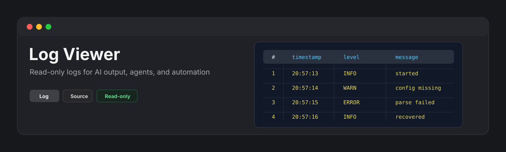
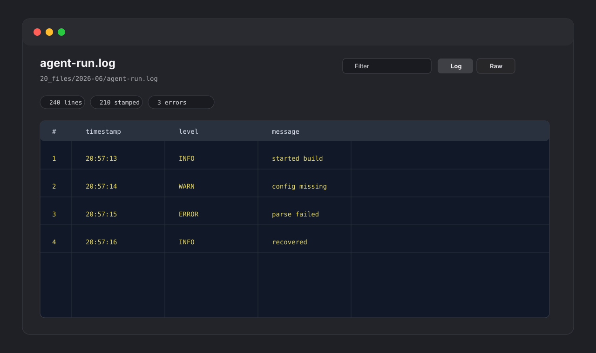

<p align="center">
  
</p>

<p align="center">
  <a href="https://github.com/viggomeesters/obsidian-log-viewer/releases/latest"></a>
  <a href="LICENSE"></a>
  
  
</p>

# Log Viewer

Log Viewer is a read-only plugin for browsing `.log` files in Obsidian. It is built for AI-output, agent logs, build logs, local automation output, and quick inspection of plaintext logs without leaving the vault.



## Features

- Opens `.log` files in a dedicated view.
- Shows a structured log table by default.
- Detects common timestamps, including ISO 8601, `YYYY-MM-DD HH:mm:ss`, `YYYYMMDD-HHmm`, and epoch values.
- Detects severity labels such as `FATAL`, `ERROR`, `WARN`, `INFO`, `DEBUG`, and `TRACE`.
- Filters visible lines by text, severity, and timestamp presence.
- Keeps a raw source view with line numbers and lightweight highlighting.
- Preserves unstructured lines and stack traces with raw fallback behavior.
- Displays line counts, timestamp counts, structured-line counts, severity counts, and render cap status.
- Applies a 10,000-line render cap to keep Obsidian responsive.
- Stays read-only by design: it never writes back to log files.

## Large files

Logs can become large quickly. Log Viewer parses the file locally and renders the first 10,000 lines to avoid flooding Obsidian with a huge DOM tree. Additional lines are counted and reported in the warning area.

## Privacy and security

Log Viewer does not make network requests and does not send vault content to external services. It does not use the system clipboard. It reads files through the vault API and renders a local view.

## Why read-only?

Logs are evidence. Editing or normalizing them can damage timestamps, stack traces, multiline records, and raw diagnostic context. Log Viewer intentionally avoids writing to disk in v0.1.

## Installation

### Community plugin directory

Log Viewer is prepared for Community plugin directory submission. Once accepted, it can be installed from **Settings -> Community plugins -> Browse**.

### Manual installation

Until the community directory submission is accepted:

1. Download `main.js`, `manifest.json`, and `styles.css` from the [latest release](https://github.com/viggomeesters/obsidian-log-viewer/releases/latest).
2. Create this folder in your vault: `.obsidian/plugins/log-viewer/`.
3. Put the downloaded files in that folder.
4. Reload the app.
5. Enable **Log Viewer** in **Settings -> Community plugins**.

### BRAT installation

For beta testing, install the plugin with [BRAT](https://github.com/TfTHacker/obsidian42-brat) using this repository URL:

```text
https://github.com/viggomeesters/obsidian-log-viewer
```

## Usage

Open any `.log` file in your vault. The file opens with Log Viewer.

Use the toolbar to:

- filter visible lines
- filter by severity
- filter by timestamp presence
- switch between structured log and raw source views
- refresh the file after external changes

## Development

```bash
npm install
npm run build
npx tsc --noEmit
npm test
```

For local development, copy or symlink this repository into `.obsidian/plugins/log-viewer/` inside a test vault.

## Release process

Community plugin files are installed from GitHub releases. For each release:

1. Update `manifest.json`, `package.json`, and `versions.json`.
2. Run `npm install`, `npm run build`, `npx tsc --noEmit`, and `npm test`.
3. Create a GitHub release whose tag exactly matches `manifest.json.version`.
4. Attach `main.js`, `manifest.json`, and `styles.css` as release assets.

## Community directory submission

The repository is prepared for Community plugin submission. The remaining submission step must be completed by the repository owner because it requires signing in, linking GitHub, and confirming the developer policies/support commitment.

Submit this repository URL:

```text
https://github.com/viggomeesters/obsidian-log-viewer
```

Official references:

- [Submit your plugin](https://docs.obsidian.md/Plugins/Releasing/Submit%20your%20plugin)
- [Obsidian releases repository](https://github.com/obsidianmd/obsidian-releases)

## License

[MIT](LICENSE)
